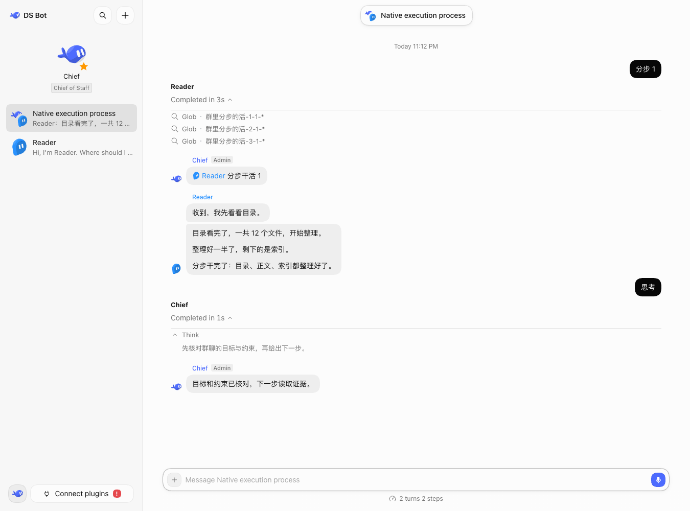

# Native execution process in Bot and group chats

## Problem and scope

Bot chats suppress ordinary tool calls and live reasoning. Group chats show member replies and a typing indicator, so users cannot inspect a member's tool input, result or failure while it works. The requested behavior is the native DSH process UI, attached to the correct member and group round.

This is a draft reference implementation for maintainer review. It does not add an agent runtime, change model routing, or infer reasoning that a provider did not return.

## Data and lifecycle

`groups.js` starts a process association before dispatching a member's group turn. The association records the round's call ID, member, delivery/exchange ID, and Session/turn/sequence references. It lives with the existing room metadata. Full tool payloads are not copied into the persisted room state.

`group-process.js` follows public Session events only for group-owned Sessions whose claimed delivery matches the association. Stable row identities include Session, turn and tool-call ID. Native result source IDs settle the existing call row. PTC events without turn fields inherit their parent's turn. Public `llm/stream` middleware observes returned blocks and yields the original chunks; it makes no additional model requests.

A read-only `room-process` endpoint returns the selected round's member processes. On reload or Host restart, the host replays public Session Controller pages within the associated sequence ranges. It reconciles stale completion state from actual turn-end records, merges replay with live events, and retains failures, interruptions and retries. Private Bot work is not associated with a group process.

## Presentation

`native-process.js` reads the registered native chat/tool components through the public Slot registry and supplies their locale, injected sources and Session owner callbacks. It reuses native tool trees and specialized result views, reasoning disclosure, and completed-turn controls without importing private DSH implementation files or copying those components.

Group-only Session references are retained while their views are mounted and released on unmount. Group processes poll while work runs, stop after settlement, and retry failed loads. Spoken progress remains in the existing group message stream rather than being shown twice. Group turn completion is shown once per member that returned process content.

## Boundaries

- Reasoning requires actual provider output; a status indicator or normal progress message is not reasoning.
- The endpoint applies saved-secret and credential redaction to text and structured result metadata; `request_secret` arguments and results stay hidden. Paths retain their original values so native file navigation still works.
- Existing question/secret cards and hidden Bot-to-Bot turns retain their existing behavior.
- Older group rounds without process associations cannot be reconstructed by this feature.
- Native component props are validated on DSH 0.2.0-rc.2. Other DSH versions and third-party toolview extensions need separate compatibility checks.

## Verification

564 unit tests cover association/isolation, result pairing, PTC children, streaming reasoning, retries, replay, interruptions, credential handling and native-renderer forwarding. All 40 isolated smoke scenarios passed. Browser acceptance exercises native tool expansion, reasoning, page reload and Host restart.

User-authorized real Desktop acceptance used separate Bots with read-only tasks: read/glob/bash in a Bot chat; four reads with one intentional missing-file failure in a two-Bot group; native result expansion, file opening and cold restart. No real-model reasoning was fabricated when the Codex provider did not expose it. Screenshots committed for review contain only the isolated mock fixture.

